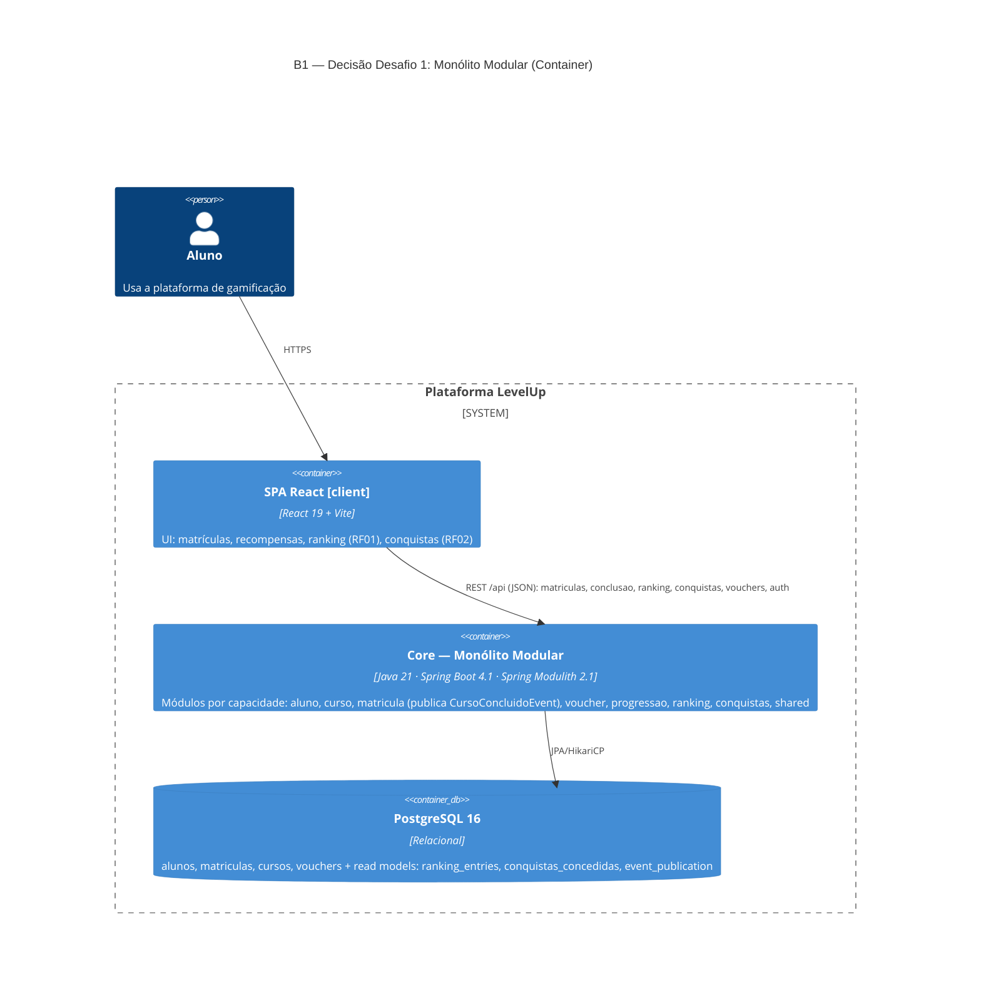

# Registro Arquitetural Vivo — B1 Architecture Lab (Grupo 7)

> Plataforma de Gamificação para Educação Continuada — evolução do MVP da AC1.
> Este é o registro cumulativo exigido pelo B1: RF/RNF → ASR → RPC → alternativas/trade-offs → ADR → C4 → evidência.
> Regra de ouro: a decisão deve poder ser lida de trás para frente — o C4 é explicado pelo ADR; o ADR é sustentado pelos ASRs/RPCs; os ASRs derivam de RF/RNF; e a evidência demonstra que o raciocínio é plausível.

---

## Desafio 1 — Drivers e Evolução do Core (Monólito em Camadas → **Monólito Modular**)

### 1. RF — o que o sistema precisa fazer

| RF | Descrição | Estado |
|---|---|---|
| **RF01 Ranking** | Top-N de alunos por moedas (desempate por cursos concluídos), cresce mais que as demais funcionalidades | ✅ `GET /ranking?top=` |
| **RF02 Conquistas** | Catálogo de conquistas por marcos (cursos/moedas/plano) com listagem e "como obter" | ✅ `GET /alunos/{id}/conquistas` |
| Evolução AC1 | Cursos, matrículas, recompensas (moedas/vouchers/cursos bônus) seguem evoluindo | preservada |

### 2. RNF (FURPS+) — qualidades em jogo

- **Performance**: leitura do ranking é desproporcional às demais; latência p95 < 500 ms como meta local de laboratório.
- **Escalabilidade**: crescimento de 1.000 → 100.000 usuários; throughput sustentado por endpoint.
- **Manutenibilidade**: equipe de 6 devs evoluindo ranking/cursos/recompensas simultaneamente.
- Testabilidade e complexidade operacional — analisadas, mas **não selecionadas como ASR** (consequência, não driver — ver §3).

### 3. ASR — requisitos arquiteturalmente significativos (máx. 3)

| # | ASR | Como altera estrutura/comunicação/dados/implantação |
|---|---|---|
| ASR-1.1 | **Desempenho do ranking** (leitura pesada desproporcional) | Separa o caminho de leitura do ranking do fluxo de escrita acadêmico: read model dedicado (`ranking_entries`) alimentado por eventos + índice composto `(moedas DESC, cursos_concluidos DESC)` — a leitura pesada não compete com as escritas do Core |
| ASR-1.2 | **Escalabilidade evolutiva** (1k → 100k usuários) | Exige fronteiras explícitas entre capacidades para permitir extração seletiva futura (ex.: ranking) sem big-bang — módulos com dependências declaradas e verificáveis |
| ASR-1.3 | **Manutenibilidade com equipe de 6** | Fronteiras de módulo + eventos de domínio permitem que ranking e conquistas evoluam sem tocar no fluxo de conclusão (adicionar RF02 = novo módulo + listener, zero mudança em código existente) |

**RNFs descartados como ASR**: testabilidade (consequência das fronteiras, não driver da decisão) e complexidade operacional (argumento *contra* distribuição — usado no trade-off de alternativas, §5).

### 4. RPC — restrições e premissas

| RPC | Implicação |
|---|---|
| Core em **Java/Spring Boot 4.1** (Java 21) | Evolução interna, não reescrita |
| Equipe de **6 desenvolvedores** | Custo de coordenação de serviços distribuídos é proibitivo agora |
| **Banco relacional** (PostgreSQL 16) e legado da AC1 | Reaproveitar entidades/regras; contrato HTTP da AC1 intocado |
| Sem necessidade comprovada de deploy independente | Medição de carga (evidência) orienta; não há demanda real hoje |

### 5. Alternativas e trade-offs

| | (A) Monólito em Camadas | (B) Monólito Modular ← **decisão** | (C) Decomposição seletiva em serviços |
|---|---|---|---|
| Desempenho (ASR-1.1) | read model possível, mas sem fronteira que o proteja | read model + evento; leitura pesada isolada por módulo | o melhor para o ranking isolado |
| Escalabilidade (ASR-1.2) | escala como um bloco único; extração futura arriscada | escala como um bloco hoje, com seams prontas para extração | escala por capacidade |
| Manutenibilidade 6 devs (ASR-1.3) | camadas transversais: toda feature cruza controller/service/repository | fronteiras por capacidades + verificação automática (Spring Modulith `verify()`) | frontieras físicas, mas coordenação de 6 devs em N deployáveis |
| Complexidade operacional | 1 deployável (mínimo) | 1 deployável (mínimo) | N deployáveis, rede, consistência — custo desproporcional |
| Dados medidos (k6, idêntico nas duas fases) | **baseline: ver §7** | **pós-modulith: ver §7** (hipótese: ≈ neutro em RPS) | não medido (fora de escopo do mini-lab) |

**Decisão do Tech Lead**: (B). Não há necessidade comprovada de escala/deploy independente — a hipótese de neutralidade de performance entre camadas e módulos foi **medida** (§7) e confirmada/refutada; a complexidade distribuída de (C) não é justificável para 6 devs sem demanda real. (A) foi descartada por não proteger os ASRs 1.2/1.3 (fronteiras inexistentes → regressão estrutural garantida com o crescimento do time/produto).

### 6. ADR-001 — Evoluir o Core para Monólito Modular (Spring Modulith)

- **Contexto**: MVP em monólito em camadas clássico (controller/service/repository) crescendo de 1.000 para 100.000 usuários; ranking cresce mais que o resto; equipe de 6; Java/Spring Boot + PostgreSQL; legado AC1 funcional.
- **ASRs/RPCs**: §3 e §4.
- **Alternativas**: §5 (A/B/C com trade-offs; B/B medidos em k6).
- **Decisão**: Monólito Modular com **Spring Modulith 2.1** — módulos por capacidade (`aluno`, `curso`, `matricula`, `voucher`, `progressao`, `ranking`, `conquistas` + `shared`), dependências explícitas via `@ApplicationModule(allowedDependencies)`, verificação automática em build (`ApplicationModules.verify()`), comunicação híbrida:
  - **queries/recompensas síncronas** via API pública do módulo (preserva o contrato HTTP da AC1 — `PATCH /conclusao` segue retornando a recompensa);
  - **efeitos colaterais de leitura** via evento de domínio `CursoConcluidoEvent` (event-carried state transfer) consumido por `ranking` e `conquistas` em `AFTER_COMMIT` síncrono com `REQUIRES_NEW` — um único evento alimenta dois módulos sem acoplar o fluxo de conclusão a nenhum deles.
- **Consequências**:
  - ✅ RF02 entrou como módulo novo + listener: **zero alteração** em matrícula/conclusão/ranking (open/closed no nível de módulo — evidência no diff do commit).
  - ✅ Fronteiras verificadas por teste em cada build; dependência ilegal quebra o CI antes de chegar ao code review.
  - ⚠️ Read model introduce **eventual consistency mínima** (listener pós-commit) — aceitável: ranking/conquistas são visões, nunca bloqueiam a conclusão.
  - ⚠️ `GET /alunos` **sem paginação** medido como gargalo real (§7): pagination é trabalho futuro recomendado (trade-off registrado, não resolvido — fora do escopo da decisão estrutural).
  - ⚠️ Virtual threads (Java 21) avaliadas em apêndice (§7.4): o teto real é o pool Hikari; pinning é risco documentado da JVM 21.

### 7. Evidência — mini-lab de carga (k6) e antes/depois de estrutura

**Protocolo** (`tools/loadtest/`): ambiente resetado por rodada (`docker compose down -v`), seed determinístico de 10.000 alunos (distribuição enviesada coerente com as regras da AC1: moedas = 3 a cada 12 cursos; PREMIUM ≥ 12), API no host (mesmo JDK 21 nas duas fases), k6 em Docker, 3 cenários **separados** (atribuição de gargalo por endpoint), rampa 10→200 VUs (30s/2min/30s), métricas Actuator (HikariCP/Tomcat) capturadas em paralelo a cada 5s.

#### 7.1 Comparativo camadas × módulos (mesmo protocolo, só a estrutura variou)

<!-- PREENCHER: tabela comparativa baseline vs pos-modulith -->

| Cenário | Fase | RPS | p95 (ms) | p99 (ms) | Erros | Gargalo observado |
|---|---|---|---|---|---|---|
| `GET /ranking?top=20` | baseline (camadas) | ⏳ | ⏳ | ⏳ | ⏳ | ⏳ |
| `GET /ranking?top=20` | pós-modulith | ⏳ | ⏳ | ⏳ | ⏳ | ⏳ |
| `GET /alunos` | baseline (camadas) | ⏳ | ⏳ | ⏳ | ⏳ | ⏳ |
| `GET /alunos` | pós-modulith | ⏳ | ⏳ | ⏳ | ⏳ | ⏳ |
| `POST matrícula → PATCH conclusão` | baseline (camadas) | ⏳ | ⏳ | ⏳ | ⏳ | ⏳ |
| `POST matrícula → PATCH conclusão` | pós-modulith | ⏳ | ⏳ | ⏳ | ⏳ | ⏳ |

#### 7.2 Antes/depois das dependências (a evidência do mini-lab)

<!-- PREENCHER: diagrama PlantUml gerado pelo Documenter do Modulith + explicacao do antes -->

#### 7.3 Métricas Actuator no pico (diagnóstico do gargalo)

<!-- PREENCHER: hikari/tomcat capturados -->

#### 7.4 Apêndice — virtual threads (Java 21)

<!-- PREENCHER: rodada VT + deteccao de pinning via jcmd -->

### 8. C4 — Container (decisão do Desafio 1)

**Leitura do diagrama**: a decisão do Desafio 1 é **interna ao Core** (um único deployável) — o Container não ganha caixas novas; o que muda é a organização interna (módulos e eventos), detalhada no Component do Desafio 2. A tabela `event_publication` (Event Publication Registry do Modulith) materializa a trilha de eventos `CursoConcluidoEvent → ranking/conquistas`.

---

## Matriz cumulativa de ASRs (evolui a cada desafio)

| Desafio | ASR | RNF de origem | Driver da decisão |
|---|---|---|---|
| 1 | ASR-1.1 Desempenho do ranking | Performance | read model dedicado via eventos |
| 1 | ASR-1.2 Escalabilidade evolutiva | Escalabilidade | módulos com fronteiras verificáveis |
| 1 | ASR-1.3 Manutenibilidade (6 devs) | Manutenibilidade | eventos desacoplam novas capacidades |

## Síntese para a Avaliação Final (AF)

- **Levar**: Monólito Modular + eventos de domínio (a base de Desafios 2/4); read model de ranking (base para extração se ASR de escala futura exigir); infra de carga k6 versionada (reutilizável em qualquer decisão de performance).
- **Não levar (ainda)**: decomposição em serviços (sem ASR que a exija); virtual threads (apêndice §7.4 — decidir com dados do ambiente real); paginação de `/alunos` (trabalho futuro recomendado).
